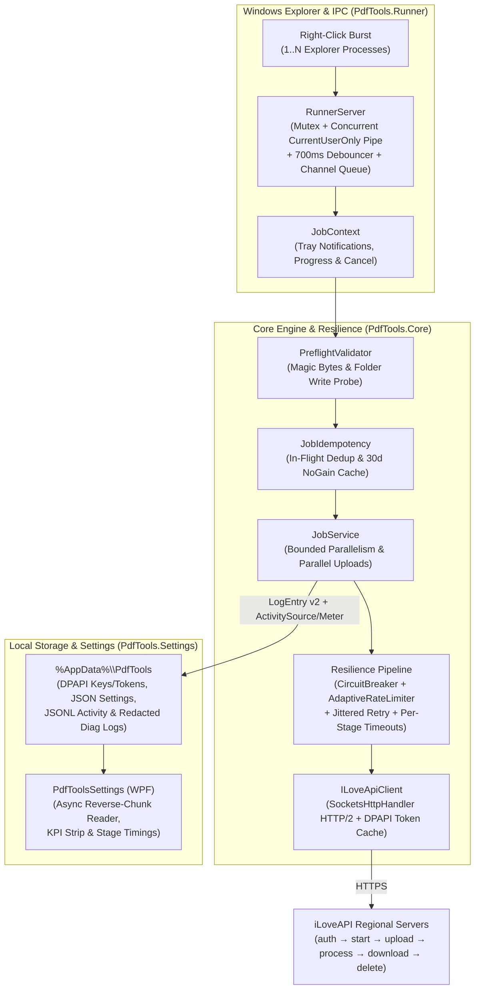

<div align="center">

   +
   &rarr;
  

  # iLovePDF Tools

  **A zero-window Windows File Explorer toolkit for compressing, merging, and converting PDFs, Office documents, and images via iLoveAPI - built on .NET 8 with zero external runtime dependencies.**

  [](https://learn.microsoft.com/en-us/dotnet/csharp/)
  [](https://dotnet.microsoft.com/)
  [](https://learn.microsoft.com/en-us/dotnet/desktop/wpf/)
  [-0078D6?style=flat-square&logo=windows&logoColor=white)](https://www.microsoft.com/windows)
  [](tests/PdfTools.Core.Tests)
  [](installer/PdfTools.iss)

  [Supported Actions](#-supported-actions) · [Key Features](#-key-features) · [Tech Stack](#-tech-stack) · [Quick Start](#-quick-start--usage) · [Architecture](#-system-architecture) · [Engineering Highlights](#-engineering-highlights) · [Privacy](#-privacy--local-data) · [Build & Tests](#-building--running-tests)

</div>

---

## 📄 Supported Actions

Skip opening a browser, uploading files, and renaming downloads. **Select files** in File Explorer, **right-click** (**Show more options** or `Shift + F10` on Windows 11), and **pick an action** - results save right next to the originals and never overwrite existing files.

| File Types | Context Menu Entry | Output Naming | Behavior |
| :--- | :--- | :--- | :--- |
| `.pdf` | **iLovePDF → Compress PDF** | `name_compressed.pdf` | Configurable level (`low`, `recommended`, `extreme`). Skips saving if output isn't smaller. |
| `.pdf` (2+ files) | **iLovePDF → Merge PDFs** | `first_merged.pdf` | Sorted in Explorer natural order (`file2.pdf` before `file10.pdf`). |
| `.doc` `.docx` `.ppt` `.pptx` | **iLovePDF: Convert to PDF** | `name.pdf` | Converts each document to its own PDF. |
| `.jpg` `.jpeg` | **iLovePDF → Convert to PDF** | `name.pdf` | Creates one fit-to-page PDF per image. |
| `.jpg` `.jpeg` (2+ files) | **iLovePDF → Combine into one PDF** | `first_combined.pdf` | Combines selected images in natural order into one PDF. |

> [!NOTE]
> **PDF to Word** is not offered because iLoveAPI has no PDF-to-Word tool.

---

## ✨ Key Features

### Right-Click Workflow
- **Zero-Window Execution** - No window opens during processing; progress and completion appear as native Windows toast notifications.
- **Click-to-Reveal & Tray Controls** - Click a finished notification to highlight the new PDF in Explorer (or open logs on errors). Right-click the tray icon mid-job to view progress or cancel the current or queued batches.
- **Collision-Safe Output** - Never overwrites existing files; automatically appends `(1)`, `(2)`, … when needed.
- **Smart Credit Protection** - Catches invalid files or read-only folders before uploading, deduplicates accidental double right-clicks, and short-circuits repeated compression of unchanged already-optimal PDFs.
- **Per-User Setup (No Admin Rights)** - Installs under `%LocalAppData%\Programs\iLovePDF Tools` using `HKCU` registry entries only, and exits cleanly when idle.

### Settings & Diagnostics UI
- **API Key & Options** - Live key validation, compression level selector, regional server choice (`Automatic`, `eu`, `us`, `fr`, `de`, `pl`, `in`, `sg`), and configurable log retention (`1–365` days).
- **Activity Log & KPI Strip** - Live summary of total jobs, success rate, space saved, average duration, and retries/failures, with action, status, and text search filters.
- **Per-Job Diagnostics** - Click any log entry to inspect its correlation ID, API worker server, HTTP status, retries, and per-stage timings (`Auth`, `Start`, `Upload`, `Process`, `Download`), or export a redacted report with **Copy diagnostics**.

---

## 🛠️ Tech Stack

| Layer | Technology | Role in iLovePDF Tools |
| :--- | :--- | :--- |
| **Core Library** | [C# 12](https://learn.microsoft.com/en-us/dotnet/csharp/), [.NET 8](https://dotnet.microsoft.com/) | Async iLoveAPI client, resilience pipeline, pre-flight validation, caching, and telemetry |
| **Shell Runner** | Windows Forms (`NotifyIcon`), Named Pipes, `System.Threading.Channels` | Zero-window Explorer entry point, multi-process batch coalescing, job queue, and tray UI |
| **Settings GUI** | [WPF (.NET 8)](https://learn.microsoft.com/en-us/dotnet/desktop/wpf/) | API key setup, preferences, async Activity Log viewer, KPI metrics, and diagnostics export |
| **Security & Storage** | Windows DPAPI (`ProtectedData`), Atomic File I/O, JSON / JSONL | Per-user encrypted key & token storage, settings, and daily rolling logs (no database needed) |
| **Installer** | [Inno Setup 6](https://jrsoftware.org/isdl.php), PowerShell | Self-contained `win-x64` per-user installer with live key verification and `HKCU` shell verbs |
| **Testing** | [xUnit](https://xunit.net/), `TimeProvider`, In-Memory `HttpMessageHandler` | 45 deterministic unit tests covering workflows, retries, circuit breaking, caching, and logs |

---

## 🚀 Quick Start & Usage

### 1. Get an iLoveAPI Public Key
1. Create a free account at [iloveapi.com/signup](https://www.iloveapi.com/signup).
2. Copy your project's **Public Key** (`project_public_...`) from [My Projects / API Keys](https://www.iloveapi.com/user/projects). *(Your secret key is never needed or stored.)*

### 2. Install
Run `iLovePDFTools-Setup-1.0.0.exe` (built via [`build.ps1`](build.ps1)):
- No UAC / administrator privileges required.
- The wizard verifies your public key live during setup. Silent installs (`/SILENT` or `/VERYSILENT`) skip the key prompt so you can add it later in **Start Menu → iLovePDF Tools Settings**.

> [!WARNING]
> The installer is currently unsigned, so Windows SmartScreen may show *"Unknown publisher"*. Click **More info → Run anyway**, or compile it directly from source below.

### 3. Use from Explorer or CLI
- **File Explorer:** Select files → right-click → **Show more options** → **iLovePDF**.
- **Settings GUI:** Open **Start Menu → iLovePDF Tools Settings** (or run `PdfToolsSettings.exe --logs` to jump straight to the Activity Log).
- **Command Line:** Invoke `PdfToolsRunner.exe` directly in scripts or terminals:

```powershell
PdfToolsRunner.exe compress   "C:\Docs\report.pdf"
PdfToolsRunner.exe merge      "C:\Docs\part1.pdf" "C:\Docs\part2.pdf"
PdfToolsRunner.exe office2pdf "C:\Docs\proposal.docx"
PdfToolsRunner.exe img2pdf    "C:\Photos\scan.jpg"
PdfToolsRunner.exe imgcombine "C:\Photos\page1.jpg" "C:\Photos\page2.jpg"
```

---

## 🏗️ System Architecture

When multiple files are selected, Windows launches one runner process per file. `PdfToolsRunner.exe` elects a single active instance that collects Explorer's burst over a `CurrentUserOnly` named pipe, queues follow-up clicks, and executes jobs through a shared resilient HTTP/2 client:



---

## ⚙️ Engineering Highlights

- **Single-Instance Multi-Process IPC ([`Program.cs`](src/PdfTools.Runner/Program.cs), [`JobContext.cs`](src/PdfTools.Runner/JobContext.cs))** - Uses a session-scoped `Mutex` and concurrent `PipeOptions.CurrentUserOnly` named-pipe listeners to coalesce Explorer's per-file launch storm (`700 ms` quiet window) into a bounded `Channel<QueuedBatch>` queue, sharing one HTTP/2 client and exiting automatically when idle.
- **Fault-Classified Circuit Breaker & Adaptive Rate Limiter ([`CircuitBreaker.cs`](src/PdfTools.Core/Resilience/CircuitBreaker.cs), [`AdaptiveRateLimiter.cs`](src/PdfTools.Core/Resilience/AdaptiveRateLimiter.cs))** - Trips on consecutive `Network`/`5xx` outages (`Closed → Open → HalfOpen`) and immediately fast-fails remaining batch items on `Auth`/`Credits` errors while isolating per-file rejections (`WrongPassword`, `DamagedFile`). Shared `Retry-After` cooldown pauses all concurrent workers together on HTTP `429`.
- **Resilient Transfers & Backoff ([`ILoveApiClient.cs`](src/PdfTools.Core/ILoveApi/ILoveApiClient.cs), [`RetryPolicy.cs`](src/PdfTools.Core/Resilience/RetryPolicy.cs))** - Full-jitter exponential backoff, per-stage timeouts (`20 s` auth/start, `3 m` process, `5 m` transfer), decoupled `401` refresh retries, mid-stream download recovery with `Content-Length` checks, and bounded parallel uploads (`MaxUploadParallel = 3`) preserving `NaturalComparer` page order.
- **Cross-Process Caching & Idempotency ([`TokenCache.cs`](src/PdfTools.Core/ILoveApi/TokenCache.cs), [`JobIdempotency.cs`](src/PdfTools.Core/Jobs/JobIdempotency.cs))** - DPAPI-encrypted JWT token cache (`50 m` TTL, keyed by `SHA-256(publicKey + apiBase)`) eliminates redundant `/auth` calls across short-lived invocations; opaque `SHA-256` fingerprints power both in-flight deduplication and the bounded 30-day `NoGain` cache.
- **Pre-Flight Safety & Atomic Writes ([`PreflightValidator.cs`](src/PdfTools.Core/Jobs/PreflightValidator.cs), [`OutputNaming.cs`](src/PdfTools.Core/OutputNaming.cs))** - Validates PDF/JPEG/Office magic bytes and output directory writability before spending API credits, enforces a `512 MB` ZIP extraction cap, and commits outputs via temp-file + race-safe `File.Move`.
- **Zero-Dependency Observability ([`Telemetry.cs`](src/PdfTools.Core/Observability/Telemetry.cs), [`JobLog.cs`](src/PdfTools.Core/JobLog.cs))** - Emits `.NET ActivitySource` spans, `Meter` counters/histograms, backward-compatible `LogEntry` v2 records with per-stage millisecond timings, a path/secret-redacting `diag-*.log`, and a 64 KB reverse-chunk log reader for non-blocking UI loads.

---

## 🔐 Privacy & Local Data

- **Immediate server cleanup:** Uploaded files are deleted from iLoveAPI (`DELETE /task/{id}`) in `finally` blocks right after download; this app keeps no copy of your documents.
- **Encrypted per-user secrets:** Both the project public key and cached JWT token are protected via Windows DPAPI (`DataProtectionScope.CurrentUser`) and cleared automatically when you change or remove your key.
- **No full paths in logs:** Activity logs store filenames only; internal diagnostic logs automatically redact directory paths, API keys, and bearer tokens.

| File in `%AppData%\PdfTools` | Contents |
| :--- | :--- |
| `credentials.dat` | DPAPI-encrypted iLoveAPI project public key |
| `token.cache` | DPAPI-encrypted temporary JWT bearer token |
| `settings.json` | Non-secret preferences (`Region`, `CompressionLevel`, `LogRetentionDays`) |
| `nogain.cache` | Opaque `SHA-256` fingerprints + expiry dates (max 500 entries; no filenames) |
| `logs\pdftools-YYYYMMDD.log` | Daily rolling JSONL activity log (auto-pruned per retention setting) |
| `logs\diag-YYYYMMDD.log` | Daily rolling redacted internal diagnostic log (`2 MB`/day cap, auto-pruned) |

---

## 📂 Project Structure

<details>
<summary>Click to expand directory tree</summary>

```text
iLovePDFToolKit/
├── assets/
│   ├── app.ico                                 # Application & context-menu icon
│   ├── ilovepdf.svg                            # Official iLovePDF brand logo
│   └── iloveapi.svg                            # Official iLoveAPI brand logo
├── installer/
│   ├── PdfTools.iss                            # Per-user Inno Setup 6 installer & HKCU shell verbs
│   └── verify-key.ps1                          # Live iLoveAPI public-key check during setup
├── src/
│   ├── PdfTools.Core/
│   │   ├── ILoveApi/                           # ILoveApiClient, ApiModels, DpapiTokenCache
│   │   ├── Jobs/                               # JobService, PreflightValidator, JobIdempotency
│   │   ├── Observability/                      # Telemetry (ActivitySource/Meter) & DiagnosticsLog
│   │   ├── Resilience/                         # CircuitBreaker, AdaptiveRateLimiter, RetryPolicy, Options
│   │   ├── AppPaths.cs                         # %AppData%\PdfTools paths & AtomicFile writes
│   │   ├── AppSettings.cs                      # Normalized JSON settings
│   │   ├── CredentialStore.cs                  # Windows DPAPI public-key store
│   │   ├── JobLog.cs                           # LogEntry v2, reverse-chunk LogReader, metrics & report builder
│   │   └── OutputNaming.cs                     # NaturalComparer & collision-free MoveUnique
│   ├── PdfTools.Runner/
│   │   ├── Program.cs                          # Entry point, single-instance RunnerServer IPC & --init
│   │   └── JobContext.cs                       # Hidden tray ApplicationContext, progress & cancellation
│   └── PdfTools.Settings/
│       ├── App.xaml / App.xaml.cs              # WPF entry point (--logs support)
│       └── MainWindow.xaml / MainWindow.xaml.cs# Settings, KPI strip, async Activity Log & diagnostics export
├── tests/
│   └── PdfTools.Core.Tests/
│       ├── CoreTests.cs                        # Naming, job workflows, errors, settings & log privacy
│       ├── ResilienceTests.cs                  # Retry/backoff, Retry-After, timeouts, circuit breaker & rate limiter
│       ├── CachingAndTransferTests.cs          # DPAPI token cache, pre-flight checks, parallel upload & ZIP cap
│       ├── IdempotencyAndQueueTests.cs         # Fingerprints, in-flight dedup, NoGain cache & cancellation
│       └── ObservabilityTests.cs               # LogEntry v2, reverse-chunk tail reader, redaction & spans
├── build.ps1                                   # Test, self-contained publish & Inno Setup packaging script
├── Directory.Build.props                       # Shared C# 12, nullable & version properties
└── PdfTools.sln
```

</details>

---

## 🧪 Building & Running Tests

### Prerequisites
- **[.NET 8 SDK](https://dotnet.microsoft.com/download/dotnet/8.0)** (Windows x64)
- **[Inno Setup 6](https://jrsoftware.org/isdl.php)** *(optional - only needed to package the `.exe` installer)*

### Run the Test Suite
All **45 unit tests** run deterministically in ~2 seconds against an in-memory `FakeApi` and `ManualTimeProvider` - no internet connection or API key required:

```powershell
git clone https://github.com/SayuruPabasara/iLovePDFToolKit.git
cd iLovePDFToolKit

dotnet test tests/PdfTools.Core.Tests -c Release
```

### Build Apps & Package Installer

```powershell
# Build Runner & Settings apps
dotnet build src/PdfTools.Runner -c Release
dotnet build src/PdfTools.Settings -c Release

# Run tests, publish self-contained win-x64 binaries, and build the installer
powershell -ExecutionPolicy Bypass -File .\build.ps1
# Output: artifacts\iLovePDFTools-Setup-1.0.0.exe
```

*(Pass `-SkipTests` to `build.ps1` to skip running `dotnet test` during packaging.)*

---

## ❓ Known Limits & Troubleshooting

- **Context menu hides when >15 files are selected** - A built-in Windows File Explorer limit for classic shell verbs. Select ≤15 files per click (triggering two quick batches queues them automatically in the active runner).
- **Menu location on Windows 11** - Classic registry verbs appear under **Show more options** (`Shift + F10`).
- **Password-protected PDFs** - iLoveAPI rejects encrypted PDFs; unlock them before compressing or merging.
- **Quotas & size limits** - Free iLoveAPI plans enforce a monthly file quota (notifications warn automatically when ≤25 credits remain). Local pre-flight validation caps individual files at `250 MB`.
- **Reporting an issue** - Open **iLovePDF Tools Settings → Activity log → Copy diagnostics** and paste the redacted summary into a [GitHub Issue](https://github.com/SayuruPabasara/iLovePDFToolKit/issues).

---

<p align="center">
  <a href="#ilovepdf-tools">⬆ Back to top</a>
</p>
