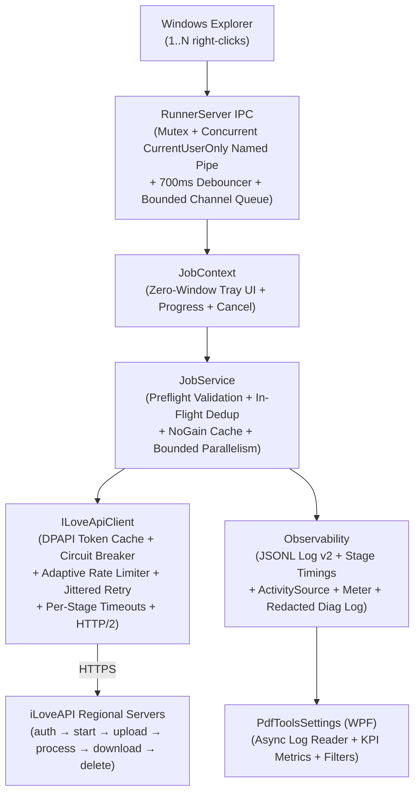

<div align="center">

  

  # iLovePDF Tools

  <p><strong>Zero-window Windows right-click PDF toolkit powered by iLoveAPI - compress, merge, and convert files directly from File Explorer.</strong></p>

  <p>
    
    
    
    
    
  </p>

  <p>
    <a href="#features">Features</a> •
    <a href="#supported-actions">Supported Actions</a> •
    <a href="#installation">Installation</a> •
    <a href="#usage">Usage</a> •
    <a href="#architecture--system-design">Architecture</a> •
    <a href="#privacy--security">Privacy &amp; Security</a> •
    <a href="#building-from-source">Build &amp; Test</a>
  </p>

</div>

---

## Overview

**iLovePDF Tools** eliminates the browser-upload-download-rename loop for everyday document tasks. Select one or more PDF, Office, or JPEG files in Windows File Explorer, right-click, and pick an action - no app window opens, results are saved right next to your originals without ever overwriting existing files, and progress appears via native Windows notifications.

Built with **.NET 8** and zero external runtime NuGet bloat, it runs only while processing jobs and exits cleanly when idle.

---

## Features

- **Native Explorer Context Menu:** Adds a clean cascading **iLovePDF** submenu for multi-action file types (`.pdf`, `.jpg`, `.jpeg`) and a single flat entry for Office files (`.doc`, `.docx`, `.ppt`, `.pptx`).
- **Zero-Window Workflow & Interactive Tray:** Progress and results appear as Windows notifications. Click a notification to reveal the output file in Explorer (or jump straight to the Activity Log on errors), or right-click the tray icon to monitor progress and gracefully cancel active or queued batches.
- **Non-Destructive Output Naming:** Writes results alongside originals (`_compressed`, `_merged`, `_combined`) and automatically appends `(1)`, `(2)`, … if a name already exists - never overwriting your files.
- **Smart Credit Protection:**
  - **Pre-flight local validation** checks file magic bytes and output-folder write access *before* uploading.
  - **No-gain detection & caching** discards compressed outputs that aren't smaller and caches unchanged already-optimal file fingerprints for 30 days so repeated runs don't waste API credits.
  - **In-flight deduplication** coalesces accidental double right-clicks on the same file.
- **Resilient Distributed Client:** Single-instance queued runner with bounded concurrency, in-memory circuit breaker, adaptive token-bucket rate limiting (`Retry-After` aware), full-jitter exponential backoff, per-stage timeouts, interrupted-download recovery, parallel multi-file uploads, and a DPAPI-encrypted cross-process JWT token cache.
- **Settings & Diagnostics Dashboard:** Dedicated WPF settings window for managing your API key, compression level, processing region, log retention, KPI metrics summary, searchable/filterable Activity Log with per-stage latency timings, and one-click redacted diagnostic export.
- **Per-User Installer (No Admin Required):** Installs to `%LocalAppData%\Programs\iLovePDF Tools` and writes only `HKCU` registry keys.

---

## Supported Actions

Right-click selected files in File Explorer (on Windows 11, choose **Show more options** or press `Shift + F10`):

| File Types | Context Menu Entry | Output Naming | Notes |
| :--- | :--- | :--- | :--- |
| `.pdf` | **iLovePDF → Compress PDF** | `name_compressed.pdf` | Configurable level (`low`, `recommended`, `extreme`). Skips saving if output is not smaller. |
| `.pdf` (2+ files) | **iLovePDF → Merge PDFs** | `first_merged.pdf` | Sorted in Explorer natural order (`file2.pdf` before `file10.pdf`). |
| `.doc` `.docx` `.ppt` `.pptx` | **iLovePDF: Convert to PDF** | `name.pdf` | Converts each document to its own PDF. |
| `.jpg` `.jpeg` | **iLovePDF → Convert to PDF** | `name.pdf` | Creates one PDF per image (fit-to-page). |
| `.jpg` `.jpeg` (2+ files) | **iLovePDF → Combine into one PDF** | `first_combined.pdf` | Combines selected images in natural order into one PDF. |

> [!NOTE]
> **PDF to Word** is intentionally not offered because iLoveAPI does not provide a PDF-to-Word conversion tool.

---

## Installation

### 1. Get a free iLoveAPI Public Key
1. Create a free account at [iloveapi.com/signup](https://www.iloveapi.com/signup).
2. Open [My Projects / API Keys](https://www.iloveapi.com/user/projects) and copy your project's **Public Key** (`project_public_...`).
   - *Your Secret Key is never required or stored.*

### 2. Run the Per-User Installer
Build the installer from source (see [Building from Source](#building-from-source)) or run `iLovePDFTools-Setup-1.0.0.exe`:
- Installs per-user under `%LocalAppData%\Programs\iLovePDF Tools` - **no administrator privileges or UAC prompt needed**.
- Includes an interactive key setup step with live verification against iLoveAPI.
- Supports silent installation (`/SILENT` or `/VERYSILENT`), which skips the key wizard so you can configure the key afterwards in **Start Menu → iLovePDF Tools Settings**.

> [!WARNING]
> Because the installer is currently unsigned, Windows SmartScreen may display an *"Unknown publisher"* warning. Click **More info → Run anyway**, or build the installer yourself directly from this repository.

---

## Usage

### Right-Click in File Explorer
1. Select one or more supported files in File Explorer.
2. Right-click → **Show more options** (Windows 11) → pick an **iLovePDF** action.
3. Wait for the Windows toast notification:
   - **Success:** Click the notification to highlight the new PDF in Explorer.
   - **Error:** Click the notification to open the **Activity Log** directly.
4. While a batch is running, right-click the **system tray icon** to view progress, **Cancel current job**, **Cancel all queued**, or open Settings.

### Settings & Activity Log
Open **Start Menu → iLovePDF Tools Settings** (or run `PdfToolsSettings.exe`, pass `--logs` to open directly on the Activity Log tab):
- **Settings tab:** Validate/update/remove your API key, choose compression level (`Low`, `Recommended`, `Extreme`), select a regional processing cluster (`Automatic`, `eu`, `us`, `fr`, `de`, `pl`, `in`, `sg`), and configure log retention (1–365 days).
- **Activity log tab:** Inspect KPI metrics (total jobs, success rate, space saved, average duration, retries/failures), filter by action/status/search query, click any row to inspect correlation ID, server node, HTTP status, and per-stage timings (`Auth / Start / Upload / Process / Download ms`), or click **Copy diagnostics** for a redacted troubleshooting summary.

### Command-Line Invocation (Power Users & Scripts)
`PdfToolsRunner.exe` can also be invoked directly from scripts or terminals:

```powershell
PdfToolsRunner.exe compress   "C:\Docs\report.pdf"
PdfToolsRunner.exe merge      "C:\Docs\part1.pdf" "C:\Docs\part2.pdf"
PdfToolsRunner.exe office2pdf "C:\Docs\proposal.docx"
PdfToolsRunner.exe img2pdf    "C:\Photos\scan.jpg"
PdfToolsRunner.exe imgcombine "C:\Photos\page1.jpg" "C:\Photos\page2.jpg"
```

---

## Architecture & System Design

When you select multiple files in Explorer and click a shell verb, Windows launches one process per file. `PdfToolsRunner.exe` coordinates these processes into a single active instance that debounces selections, buffers follow-up bursts, and executes jobs through a resilient pipeline:



### Repository Layout

| Project / Path | Purpose |
| :--- | :--- |
| [`src/PdfTools.Core`](src/PdfTools.Core) | Core library: `ILoveApiClient`, resilience primitives (`CircuitBreaker`, `AdaptiveRateLimiter`, `RetryPolicy`), DPAPI `CredentialStore` & `DpapiTokenCache`, `JobService`, `PreflightValidator`, `JobIdempotency`, `OutputNaming`, `JobLog`, and `Telemetry`. |
| [`src/PdfTools.Runner`](src/PdfTools.Runner) | Shell entry point (`PdfToolsRunner.exe`): single-instance IPC coordinator (`RunnerServer`), `Channel<QueuedBatch>` queue, tray progress/cancel UI (`JobContext`), and installer `--init` helper. |
| [`src/PdfTools.Settings`](src/PdfTools.Settings) | WPF settings & diagnostics GUI (`PdfToolsSettings.exe`): API key setup, options, async Activity Log viewer, KPI metrics, and redacted diagnostic export. |
| [`tests/PdfTools.Core.Tests`](tests/PdfTools.Core.Tests) | xUnit test suite (45 deterministic tests) covering naming, job workflows, resilience, caching, pre-flight checks, idempotency, and observability via an in-memory fake API and manual `TimeProvider`. |
| [`installer/`](installer) | Per-user Inno Setup 6 script (`PdfTools.iss`) and setup key verification script (`verify-key.ps1`). |

<details>
<summary><strong>Deep Dive: Reliability, Caching & Observability Practices</strong></summary>

- **Caching:** Cross-process DPAPI-encrypted JWT token cache (`token.cache`, 50-min TTL with 2-min refresh margin, invalidated automatically on key change) eliminates redundant `/v1/auth` round-trips across short-lived Explorer invocations. A bounded 30-day `NoGain` cache (`nogain.cache`) avoids re-spending credits on unchanged already-optimal PDFs.
- **Queueing & Rate Limiting:** A single active runner accepts concurrent incoming Explorer clicks over a `CurrentUserOnly` named pipe into a bounded `System.Threading.Channels` queue, sharing one `SocketsHttpHandler` (HTTP/2 pooling) and an `AdaptiveRateLimiter` that pauses all workers together on HTTP `429` / `Retry-After`.
- **Circuit Breaking & Retries:** Transient `Network`/`5xx` faults retry with full-jitter exponential backoff and per-stage timeouts (`20s` auth/start, `3m` process, `5m` upload/download, including mid-stream download interruption recovery). Consecutive outages trip an in-memory circuit breaker (`Closed → Open → HalfOpen`), and account-level `Auth`/`Credits` faults immediately fast-fail remaining batch items - while per-file faults (`WrongPassword`, `DamagedFile`) stay isolated.
- **Observability:** Every job item emits `.NET ActivitySource` spans, `Meter` counters/histograms, and a backward-compatible JSON-lines `LogEntry` v2 record containing `CorrelationId`, `ApiTaskId`, `ApiServer`, `FailedStage`, `ErrorKind`, `HttpStatus`, `RetryCount`, input/output byte counts, and per-stage millisecond timings. Log reading streams files in reverse 64 KB chunks off the UI thread.

</details>

---

## Privacy & Security

- **No local document copies & immediate remote cleanup:** Files are uploaded over HTTPS directly to iLoveAPI for processing and deleted from iLoveAPI servers (`DELETE /task/{id}`) immediately after download.
- **Public-key auth only:** Only the project public key is stored, encrypted per Windows account via **Windows DPAPI** (`DataProtectionScope.CurrentUser`).
- **Privacy-preserving logs:** Activity logs and diagnostic logs record only **file names** (never full directory paths, file contents, API keys, or bearer tokens). Diagnostic errors automatically redact paths and secrets.
- **Local IPC & archive hardening:** Named pipes enforce `PipeOptions.CurrentUserOnly`, and ZIP outputs enforce an uncompressed size ceiling (512 MB) against malformed archives.

### Local Data Directory (`%AppData%\PdfTools`)

| File / Folder | Contents |
| :--- | :--- |
| `credentials.dat` | DPAPI-encrypted iLoveAPI project public key |
| `token.cache` | DPAPI-encrypted temporary JWT bearer token (cleared automatically when key changes) |
| `settings.json` | Non-secret user options (`Region`, `CompressionLevel`, `LogRetentionDays`) |
| `nogain.cache` | Bounded cache of opaque SHA-256 fingerprints + expiry timestamps (no filenames/paths) |
| `logs\pdftools-YYYYMMDD.log` | Daily rolling JSON-lines activity log (auto-pruned per retention setting) |
| `logs\diag-YYYYMMDD.log` | Daily rolling redacted internal diagnostic log (2 MB/day cap, auto-pruned) |

---

## Building from Source

### Prerequisites
- [.NET 8 SDK](https://dotnet.microsoft.com/download/dotnet/8.0) (Windows x64)
- [Inno Setup 6](https://jrsoftware.org/isdl.php) *(only needed to package the `.exe` installer)*

### Run Tests & Build

```powershell
git clone https://github.com/SayuruPabasara/iLovePDFToolKit.git
cd iLovePDFToolKit

# Run all 45 unit tests (in-memory fake API, no internet or API key required)
dotnet test tests/PdfTools.Core.Tests -c Release

# Build the Runner and Settings apps
dotnet build src/PdfTools.Runner -c Release
dotnet build src/PdfTools.Settings -c Release
```

### Build the Self-Contained Installer

```powershell
powershell -ExecutionPolicy Bypass -File .\build.ps1
# Output: artifacts\iLovePDFTools-Setup-1.0.0.exe
```

Use `-SkipTests` to skip running `dotnet test` during packaging.

---

## Troubleshooting & Known Limits

- **Context menu disappears when selecting >15 files:** This is a built-in Windows File Explorer limit for classic shell verbs. Select 15 or fewer files per right-click (or trigger two quick batches - the single-instance runner will queue them smoothly).
- **Menu doesn't show directly on Windows 11:** Classic registry verbs live under **Show more options** (`Shift + F10`).
- **Password-protected PDFs:** iLoveAPI rejects encrypted PDFs; unlock the PDF before compressing or merging.
- **API quotas & file size limits:** Free iLoveAPI plans include a monthly file quota; remaining credits appear automatically in notifications when ≤ 25 credits remain. Local pre-flight validation also caps individual files at 250 MB.
- **Reporting an issue:** Open **iLovePDF Tools Settings → Activity log → Copy diagnostics** and paste the redacted summary into a [GitHub Issue](https://github.com/SayuruPabasara/iLovePDFToolKit/issues).
